# Community Moderation Plugin

A Mattermost plugin that adds community moderation tools directly to the channel view — member reporting, a moderation queue, mutes, timeouts, warnings, and member management — without opening the System Console.

## Features

### For everyone

- **Report a message or a member** from the message menu or a member's profile popover. Pick a reason (spam or scam, harassment or abuse, impersonation, inappropriate content, or something else) and add optional context for the moderation team.
- Reports are private: the reported member never sees who submitted them.
- **Abuse protection**: reports are rate limited per member (5 per 10 minutes by default, configurable), and re-reporting the same message or member while a report is still open is rejected — so nobody can flood the moderation queue.

| Report a message | Duplicate reports are rejected |
| --- | --- |
| 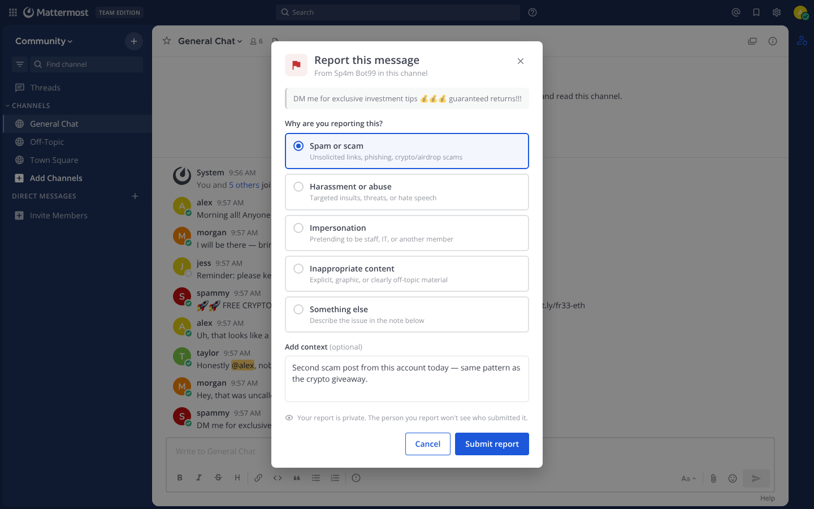 | 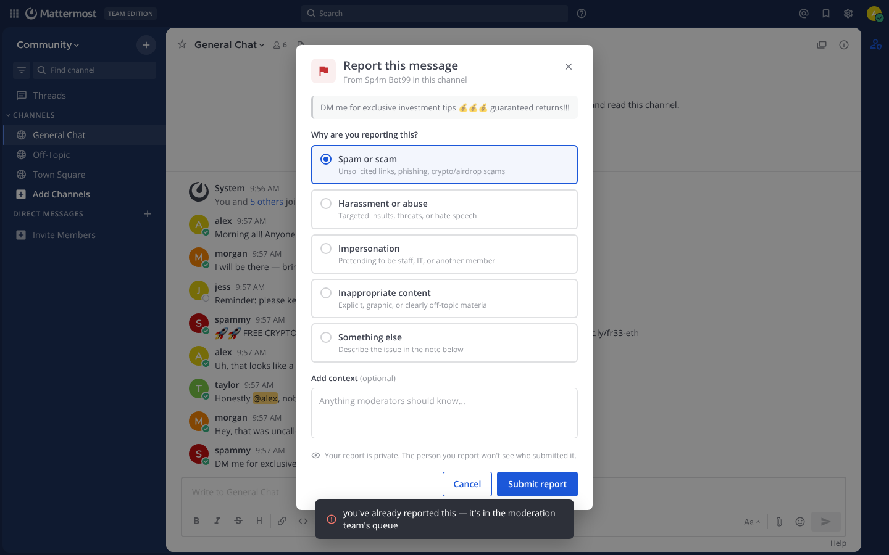 |

### For moderators

- **Moderation panel** in the channel header (shield icon) with a live badge showing the number of open reports in the channel.
- **Report queue**: every report shows its status (needs review, escalated, resolved), reason, reporter, the reported member, and an excerpt of the reported message. Act on a report directly from the card — timeout, mute, escalate to admins, or dismiss.
- **Message actions** from any message's dropdown menu: mute in channel, timeout, warn, and delete message.
- **Mutes and timeouts are enforced server-side.** Muted or timed-out members stay in the channel but can't post, edit their messages, or react until the restriction ends; timeouts run for 5 minutes, 1 hour, 24 hours, or 7 days. They're told why right under the message box, before anything is sent.
- Muting or timing out a member from the queue resolves all of their open reports in the channel; deleting a message resolves every report about it.
- Moderation actions only apply to members of the channel they're taken in.
- **Warnings** are delivered as a direct message from the Community Moderation bot, as are notices about mutes, timeouts, and deleted messages.
- New reports are DM'd to the channel's moderators (or to system admins when a channel has no moderators yet).
- The queue lists reports that still need action first; resolved reports follow.

| Report queue | Message actions for moderators |
| --- | --- |
| 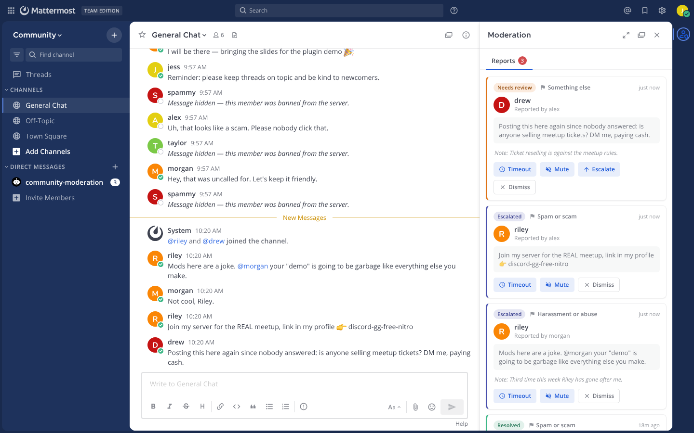 | 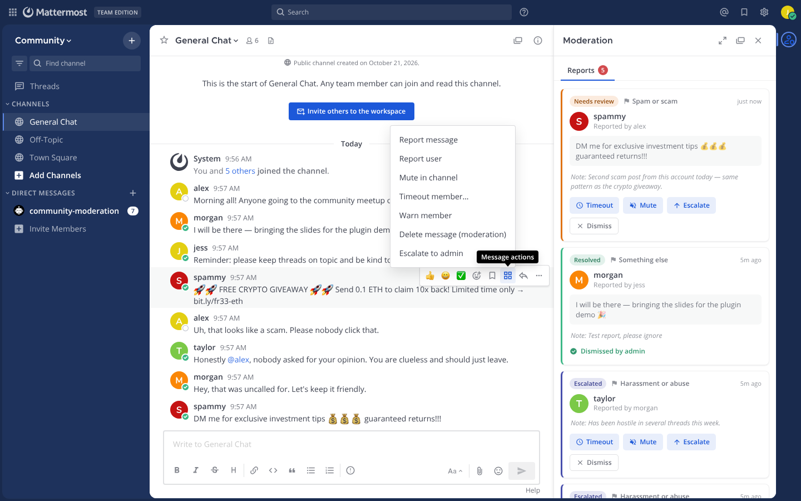 |
| Timeout from a report | Timed-out members see why they can't post |
| 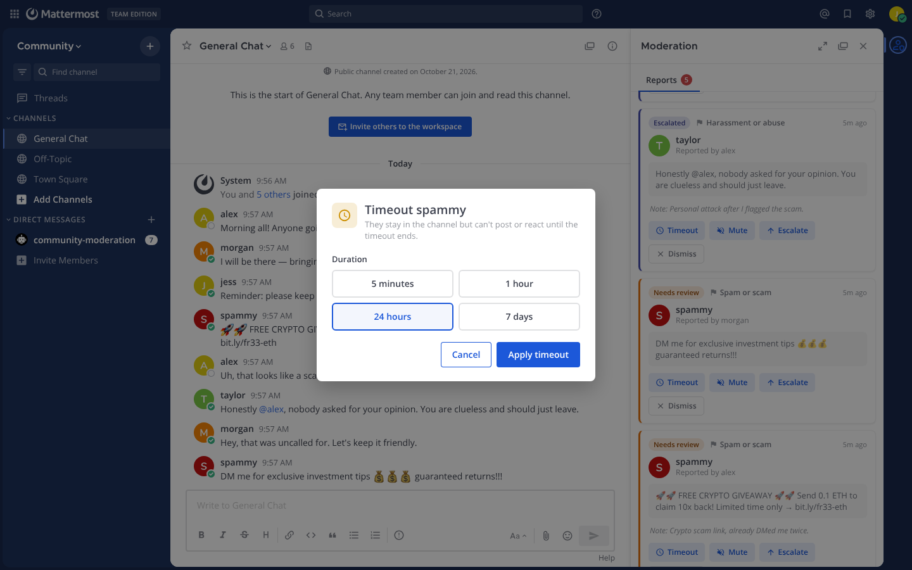 | 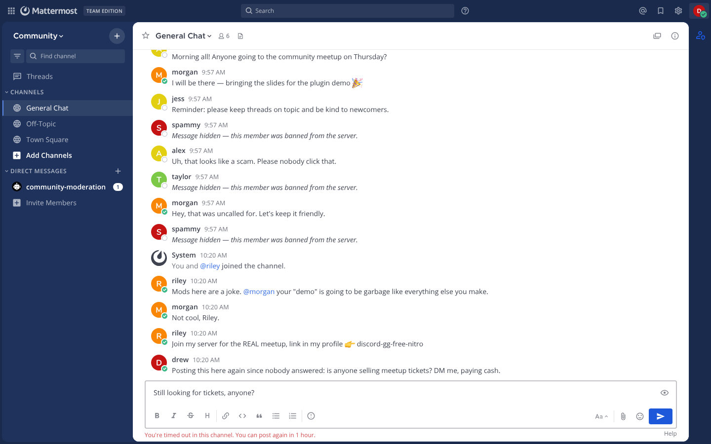 |
| Notice sent to the timed-out member | New reports are DM'd to moderators |
| 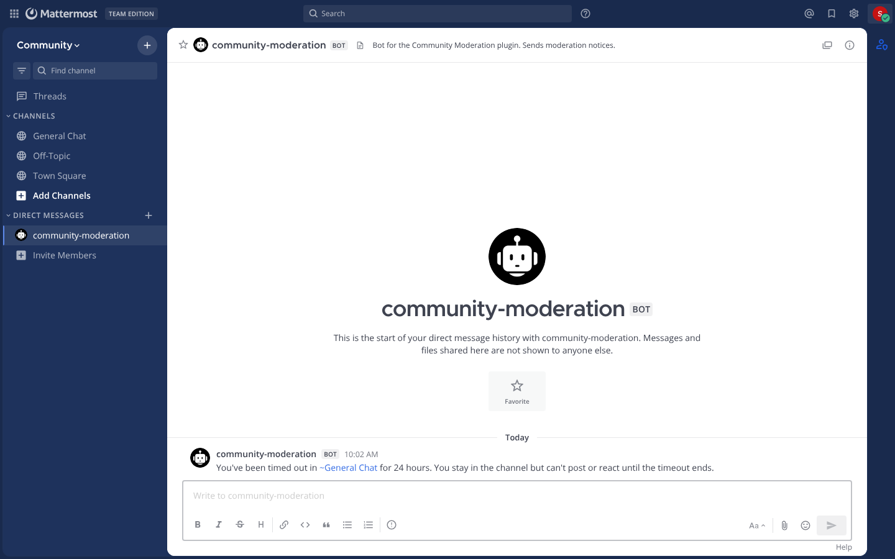 | 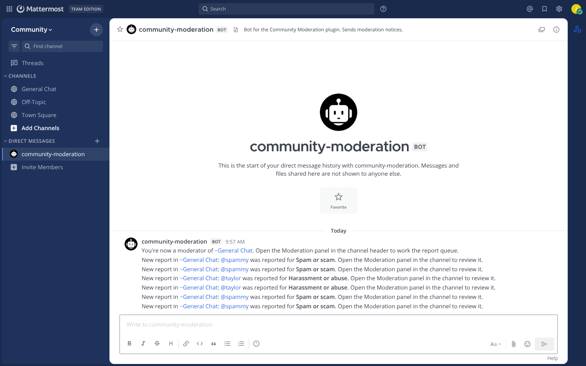 |

### For admins

Admins (system admins and team admins) can do everything moderators can, plus:

- **Members & roles tab** in the moderation panel: assign or remove channel moderators, lift mutes and timeouts, remove members from the channel, and ban or unban members. The list shows members with an elevated role or an active restriction; a search box finds any other channel member to elevate or manage.
- **Ban from server**: deactivates the account so the member can't sign back in, and by default replaces their username and name with a placeholder. If their profile picture is offensive too, tick **Also remove their profile picture** in the ban dialog to replace it with a neutral placeholder; otherwise the picture is kept. A removed picture isn't restored if the ban is lifted. Bans can be reversed from the member list by a system admin or an admin of the team where the ban was issued. Accounts deactivated outside the plugin can only be reactivated from the System Console.
- Moderators can **escalate** a member's open reports to admins, which notifies every system admin by DM. Reports that are already escalated can't be escalated again.

| Members & roles tab | Profile popover actions |
| --- | --- |
| 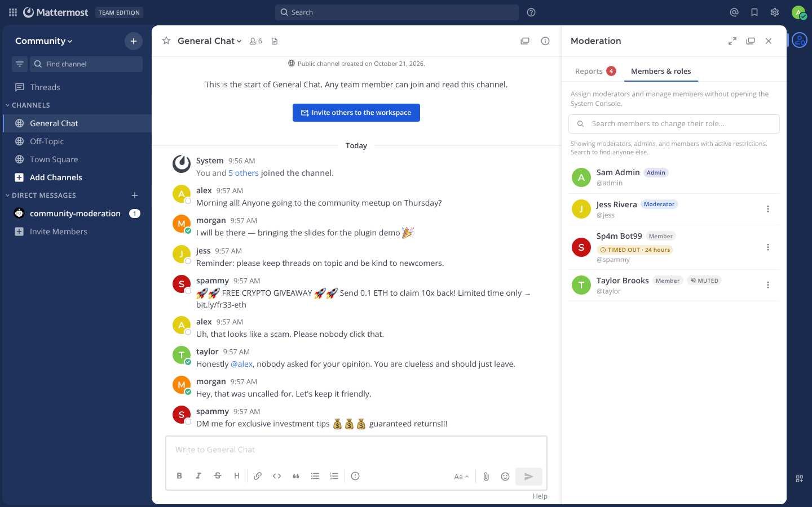 | 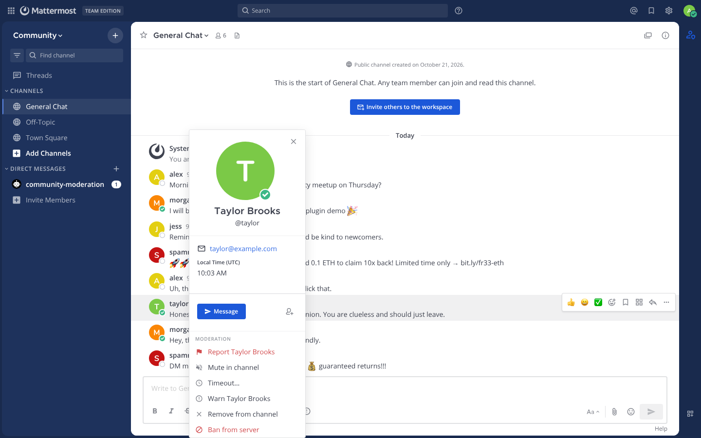 |
| Ban confirmation | Banned members' messages and usernames hidden |
| 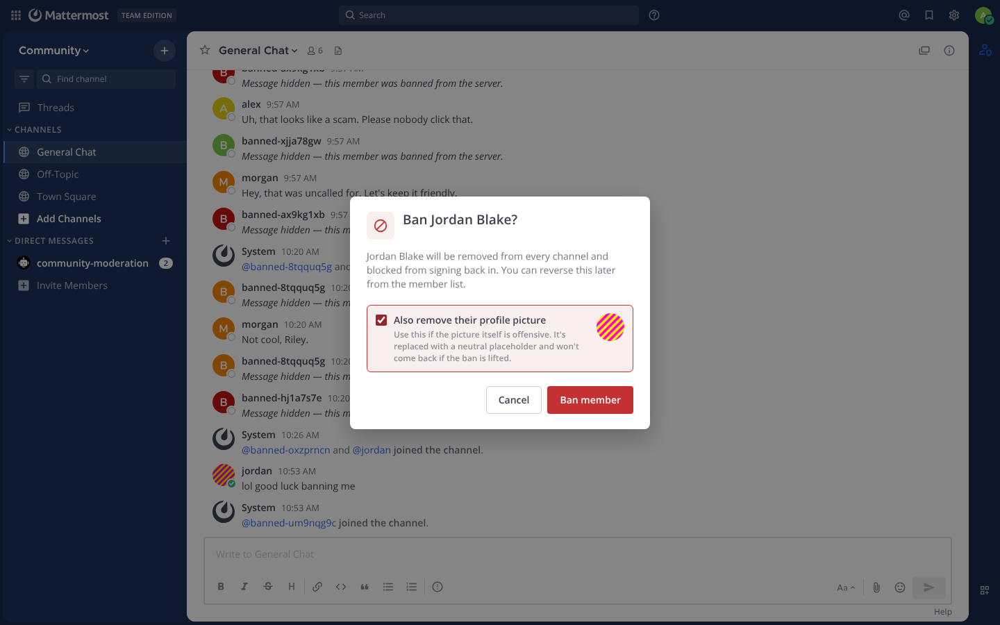 | 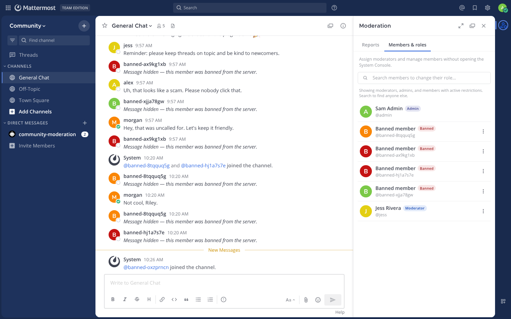 |

### Settings

Under **System Console → Plugins → Community Moderation**:

- **Hide messages from banned members** — when a member is banned, hide their recent messages in the channel where the ban was issued.
- **Hide banned members' usernames** — replace a banned member's username and name with a placeholder (`banned-1a2b3c4d`, shown as "Banned member") everywhere they appear, so an offensive or impersonating name disappears along with the member. Unbanning restores the original username and name.
- **Banned message display** — show a placeholder ("Message hidden — this member was banned from the server.") in place of each hidden message, or remove the messages entirely.
- **Maximum reports per member** and **report rate limit window** — the rolling per-member cap on report submissions (default 5 per 10 minutes; set the cap to 0 to disable).

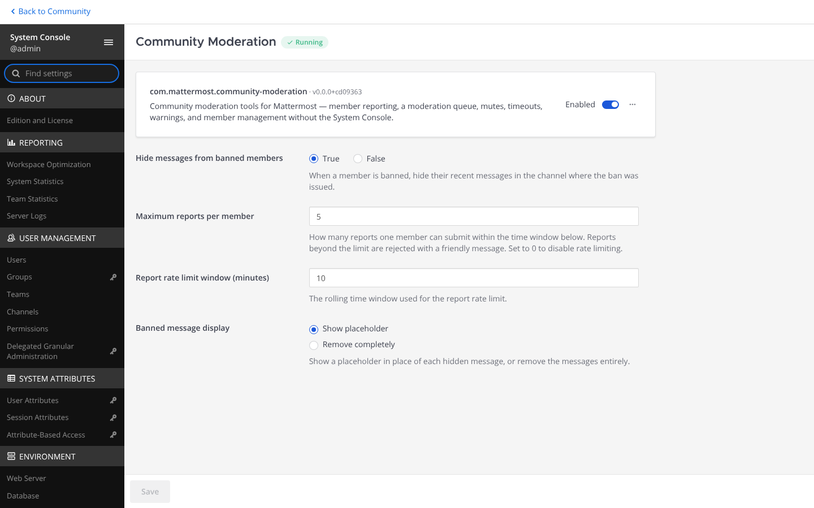

## Roles

| Capability | Member | Moderator | Admin |
| --- | :-: | :-: | :-: |
| Report messages and members | ✓ | ✓ | ✓ |
| Work the report queue | | ✓ | ✓ |
| Mute, timeout, warn, delete messages | | ✓ | ✓ |
| Escalate to admins | | ✓ | |
| Ban/unban, remove from channel | | | ✓ |
| Assign channel moderators | | | ✓ |

- **Admins** are system admins and admins of the channel's team.
- **Moderators** are members granted the role per channel by an admin, plus channel admins.
- Moderators can't act on other moderators or admins; admins can act on moderators but not on other admins.

## Installation

1. Download the latest release from the [releases page](https://github.com/svelle/mattermost-plugin-moderation/releases).
2. Upload it in **System Console → Plugins → Plugin Management**, or manually place it in the server's plugin directory.
3. Enable the plugin.

## Development

This plugin contains both a server and web app portion. Read the [Mattermost plugin developer documentation](https://developers.mattermost.com/extend/plugins/) for general plugin development guidance.

Build your plugin:

```bash
make
```

This will produce a single plugin file (with support for multiple architectures) for upload to your Mattermost server:

```
dist/com.mattermost.community-moderation.tar.gz
```

### Deploying with local mode

If your Mattermost server is running locally, you can enable [local mode](https://docs.mattermost.com/administration/mmctl-cli-tool.html#local-mode) to streamline deploying your plugin. Edit your server configuration as follows:

```json
{
    "ServiceSettings": {
        "EnableLocalMode": true,
        "LocalModeSocketLocation": "/var/tmp/mattermost_local.socket"
    }
}
```

and then deploy your plugin:

```bash
make deploy
```

You may also customize the Unix socket path:

```bash
export MM_LOCALSOCKETPATH=/var/tmp/alternate_local.socket
make deploy
```

If developing a plugin with a web app, watch for changes and deploy those automatically:

```bash
export MM_SERVICESETTINGS_SITEURL=http://localhost:8065
export MM_ADMIN_TOKEN=j44acwd8obn78cdcx7koid4jkr
make watch
```

### Deploying with credentials

Alternatively, you can authenticate with the server's API with credentials:

```bash
export MM_SERVICESETTINGS_SITEURL=http://localhost:8065
export MM_ADMIN_USERNAME=admin
export MM_ADMIN_PASSWORD=password
make deploy
```

or with a [personal access token](https://docs.mattermost.com/developer/personal-access-tokens.html):

```bash
export MM_SERVICESETTINGS_SITEURL=http://localhost:8065
export MM_ADMIN_TOKEN=j44acwd8obn78cdcx7koid4jkr
make deploy
```

### How it works

- **Server (Go)** stores reports, restrictions (mutes/timeouts), bans, and per-channel moderator lists in the plugin KV store. Restrictions are enforced in the `MessageWillBePosted` hook (and by removing reactions from restricted members). Bans deactivate the account. Websocket events keep every open moderation panel in sync.
- **Web app (React)** registers a channel header button, a right-hand sidebar (report queue + members & roles), post dropdown menu actions, profile popover actions, and the report/timeout/confirm modals.

## License

Apache License 2.0 — see [LICENSE](LICENSE).
